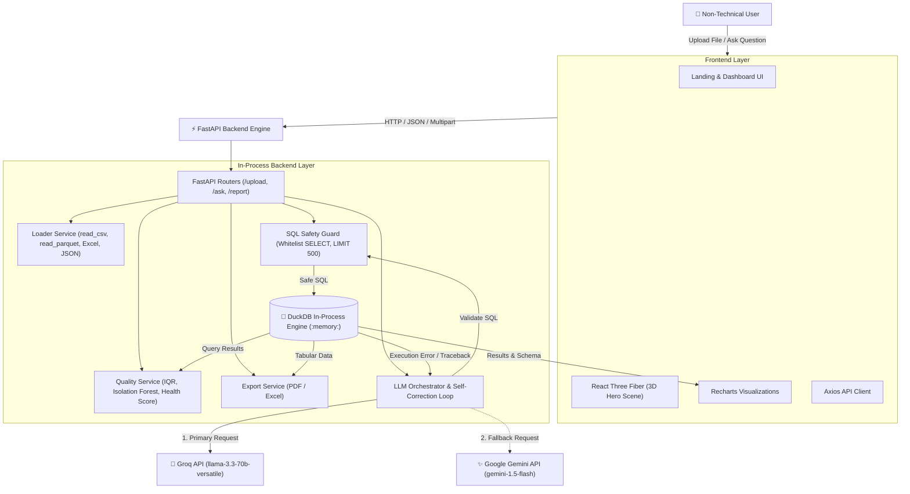

# DataChat: Conversational Data Analytics Using DuckDB

DataChat is a full-stack, zero-database-server conversational analytics platform. Non-technical users can upload tabular datasets (CSV, TSV, Excel, JSON, Parquet up to 200MB), instantly receive an automated data-quality and health report, and ask natural language analytical questions. An LLM translates questions into DuckDB SQL, executes them in-process, and renders conversational summaries, interactive tables, and charts.

---

## 🏛️ Architecture Overview



---

## 🚀 Key Features

1. **Multi-Format Ingestion**:
   - Native support for **CSV**, **TSV**, **Excel (.xlsx / .xls with multi-sheet selector)**, **JSON** (records or objects), and **Parquet**.
   - Enforces 200 MB maximum file size limit and prevents 0-byte uploads.
2. **Instant Data-Quality & Health Profiling**:
   - Computes row count, column count, distinct counts, and null percentages.
   - Detects exact duplicate records.
   - **Outlier Detection**: Interquartile Range (IQR) rule per numeric column plus **Isolation Forest** (multivariate anomaly detection via `scikit-learn`).
   - Calibrated **Data Health Score (0 to 100)** with status ratings (*Excellent*, *Good*, *Moderate*, *Poor*).
3. **Conversational NL-to-SQL Engine**:
   - Zero-shot schema injection with data types and 3 non-null sample values.
   - Conversational memory preserves context across follow-up queries (e.g. *"Now sort that by profit"*).
4. **SQL Safety Guard**:
   - Whitelists only safe `SELECT` and `WITH ... SELECT` queries.
   - Blocks data and DDL mutations: `DROP`, `DELETE`, `UPDATE`, `INSERT`, `ALTER`, `CREATE`, `ATTACH`, `COPY`, `PRAGMA`, `EXECUTE`, `TRUNCATE`.
   - Prevents multi-statement SQL attacks (semicolon chaining).
   - Enforces automatic `LIMIT 500` bounding and query execution timeouts.
5. **Self-Correcting SQL Loop**:
   - If DuckDB raises a syntax error or runtime exception, the error message and failed SQL are fed back into the LLM.
   - Automatically retries and corrects up to **3 attempts**.
6. **Smart Visualization & Chart Selection**:
   - Automatic shape detection selects between **Bar Charts**, **Line Charts** (time-series), **Pie Charts** (categorical proportions), or **KPI Metric Cards** using Recharts.
   - Results include plain-English conversational summaries, collapsible **"View SQL"** drawers, and interactive data tables.
7. **AI Suggested Questions**:
   - Generates 4 tailored starter analytical questions as clickable chips upon upload.
8. **Export Suite**:
   - One-click downloads for full data quality profiling and Q&A history in **Excel (.xlsx)** or **PDF Report** format.
9. **Lightweight 3D Aesthetics**:
   - Interactive React Three Fiber scene with rotating wireframe data cubes and illuminated nodes.
   - Includes an instant **"Reduce Motion"** toggle in the header.

---

## 🛠️ Project Structure

```
datachat/
├── backend/
│   ├── main.py                  # FastAPI server application
│   ├── requirements.txt         # Backend Python dependencies
│   ├── .env.example             # Environment variable template
│   ├── routers/
│   │   └── api.py               # /upload, /ask, /report/{id}, /health endpoints
│   ├── services/
│   │   ├── loader.py            # In-process DuckDB loader for all formats
│   │   ├── quality.py           # IQR, Isolation Forest, Health score (0-100)
│   │   ├── sql_guard.py         # Read-only SELECT whitelist & LIMIT enforcement
│   │   ├── llm.py               # Groq primary, Gemini fallback, self-correction
│   │   ├── charts.py            # Automatic chart selection (bar, line, pie, KPI)
│   │   └── export.py            # Excel & ReportLab PDF generator
│   └── tests/
│       ├── test_loader.py       # Unit tests for loading and DuckDB execution
│       ├── test_quality.py      # Tests for IQR, Isolation Forest & health score
│       ├── test_sql_guard.py    # Security tests for SQL safety guard
│       └── test_api.py          # Integration tests for FastAPI endpoints
├── frontend/
│   ├── src/
│   │   ├── App.jsx              # Main UI coordinator
│   │   ├── api/client.js        # Axios API client
│   │   └── components/
│   │       ├── HeroScene.jsx    # React Three Fiber 3D background with motion toggle
│   │       ├── FileUploader.jsx # Drag-and-drop file uploader
│   │       ├── QualityDashboard.jsx # KPI cards, missing chart & data preview
│   │       ├── ChatPanel.jsx    # Conversational chat, suggested chips, SQL viewer
│   │       └── ChartRenderer.jsx# Recharts bar, line, pie, and metric visualizer
│   └── package.json
├── eval/
│   ├── questions.json           # 20 diverse analytical benchmark questions
│   └── run_eval.py              # CLI evaluation tool for accuracy & latency
├── sample_data/
│   ├── sales_data.csv           # 101 sales orders with nulls, duplicates & outliers
│   ├── student_marks.xlsx       # Multi-sheet workbook (Students, ExamScores)
│   ├── expenses.json            # Departmental budget vs spend
│   ├── sales_data.parquet       # Parquet sample
│   ├── expenses.tsv             # TSV sample
│   └── generate_samples.py      # Sample data generation script
└── README.md
```

---

## ⚙️ Quickstart & Setup Guide

### Prerequisites
- Python 3.11+
- Node.js 18+ and npm

### 1. Backend Setup
1. Open a terminal in the root `c:\Datachat`:
   ```bash
   cd backend
   ```
2. Copy the `.env.example` file to `.env`:
   ```bash
   cp .env.example .env
   ```
3. Configure your API keys in `backend/.env`:
   ```ini
   GROQ_API_KEY=your_groq_api_key_here
   GEMINI_API_KEY=your_gemini_api_key_here
   GROQ_MODEL=llama-3.3-70b-versatile
   GEMINI_MODEL=gemini-1.5-flash
   PORT=8000
   HOST=0.0.0.0
   ```
4. Install Python dependencies:
   ```bash
   python -m pip install -r requirements.txt
   ```
5. Run the test suite:
   ```bash
   python -m pytest backend/tests/ -v
   ```
6. Start the FastAPI backend server:
   ```bash
   uvicorn backend.main:app --host 0.0.0.0 --port 8000 --reload
   ```

### 2. Frontend Setup
1. Open another terminal in `c:\Datachat\frontend`:
   ```bash
   cd frontend
   npm install
   ```
2. Start the Vite development server:
   ```bash
   npm run dev
   ```
3. Open your browser at `http://localhost:5173`.

---

## 📊 Evaluation CLI Runner

Run the automated evaluation benchmark across the 20 analytical questions:

```bash
# Run with DuckDB benchmark query mapping
python eval/run_eval.py --mock-llm

# Run live with LLM generation and self-correction
python eval/run_eval.py
```

---

## ⚠️ System Limitations & Considerations

1. **In-Memory DuckDB Scope**: Tables are held in-process memory. Restarting the backend server clears registered tables from RAM.
2. **File Size Bounds**: Files are bounded to 200 MB to preserve in-memory efficiency on local machines.
3. **Read-Only Enforcements**: Schema changes, table alterations, and file writes are blocked by design.
4. **LLM Provider Availability**: Requires an active Groq or Gemini API key with network connectivity for natural language query generation.
