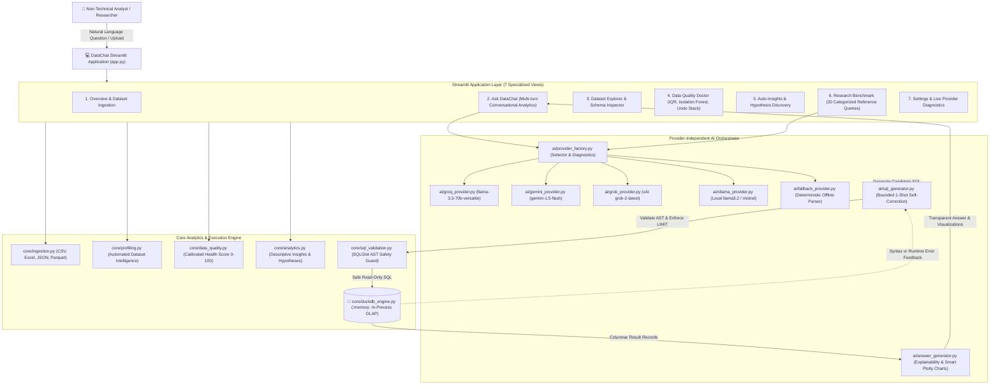

# DataChat — Trustworthy Conversational Data Analytics Platform Using DuckDB

[](https://duckdb.org/)
[](https://sqlglot.com/)
[](https://streamlit.io/)
[](https://python.org/)
[](file:///c:/Datachat/tests)

**DataChat** is a research-grade, zero-database-server conversational analytics platform developed for the college ROSP (Recent Open Source Research Lab) project. 

Rather than functioning as a black-box AI wrapper that hallucinates data calculations or executes dangerous arbitrary code, DataChat operates on a principled **in-process columnar OLAP architecture**: user questions are transformed into verifiable, read-only DuckDB SQL, strictly validated through **SQLGlot AST analysis**, executed in-memory against zero-copy columnar data, and presented alongside transparent justifications, empirical performance metrics, and interactive visualizations.

---

## 🏛️ System Architecture



---

## 🔍 Root Cause Analysis of the Original Grok Failure

A thorough diagnostic trace of the original configuration and integration revealed **four compound root causes**:

1. **Groq (Inference Engine) vs xAI Grok (LLM Product) Confusion**:
   - The application documentation and prompt referred to the "Grok API" (xAI's model), but the code exclusively targeted `https://api.groq.com` (Groq Inc., the LPU hardware company) using a Groq API key format (`gsk_...`).
   - The official xAI Grok API endpoint is `https://api.x.ai/v1/chat/completions` requiring an `XAI_API_KEY` (`xai-...`) and model names such as `grok-2-latest` or `grok-beta`.
2. **Invalid Model Identifiers**:
   - In `backend/.env`, the Groq model was configured as `GROQ_MODEL=qwen/qwen3.8-27b`. Groq does not host this model identifier; requests resulted in HTTP 400/404 `model_not_found` errors. Valid Groq models include `llama-3.3-70b-versatile` and `llama-3.1-8b-instant`.
   - Similarly, `GEMINI_MODEL=gemini-2.5-flash` was set in `.env`, which is not an available production model endpoint on Google Gemini v1beta (valid models are `gemini-1.5-flash`, `gemini-1.5-pro`, `gemini-2.0-flash`).
3. **Absence of a Provider Abstraction Layer**:
   - The codebase lacked a clean provider interface. Models, endpoints, and headers were hardcoded in monolithic helper functions without standardized exception translation (`ProviderAuthError`, `InvalidModelError`, `ProviderTimeoutError`).
4. **Lack of a Genuine Degraded No-API Fallback Mode**:
   - When credentials were missing, expired, or rate-limited, the application immediately crashed with `LLMConfigurationError` or `RuntimeError` rather than providing deterministic analytical answers from the dataset.

### The Solution Implemented
- Designed a unified `BaseAIProvider` interface with concrete implementations for **Groq**, **Google Gemini**, **xAI Grok**, **Ollama (local)**, and **Deterministic Fallback**.
- Built a live diagnostics engine that verifies connectivity, models, and keys without ever exposing secrets.
- Implemented a deterministic rule-based analytical parser in `ai/fallback_provider.py` that translates queries into valid DuckDB SQL even when completely offline with zero API keys configured.

---

## 🚀 Key Standout Features

### 1. Automatic Dataset Intelligence & Profiling (Feature A)
- Comprehensive schema analysis: row count, column count, memory footprint, completeness percentage.
- Inferred semantic data types: `Numeric`, `Categorical`, `Datetime`, `Boolean`, and `Text`.
- Five-number summaries (min, q25, median, mean, q75, max, std, skewness).
- Automatic generation of actionable data warnings (high missingness, constant columns, duplicate records).

### 2. Data Quality Doctor & Undo Stack (Feature B)
- **Calibrated Data Health Score (0 to 100)** weighted across missing cells (40%), duplicate rows (30%), and outlier rates (30%).
- **Dual Outlier Detection**: Interquartile Range (IQR 1.5x) rule per numeric column plus scikit-learn **Isolation Forest** for multivariate anomaly detection.
- **Safe, Explainable Transformations with Live Previews**:
  - Duplicate record removal.
  - Missing value imputation (`mean`, `median`, `mode`, `zero`).
  - IQR outlier clipping / clamping to preserve valid observation counts.
  - Text whitespace trimming.
- **History Stack**: Undo/revert any transformation or restore the pristine original dataset at any time.
- **Cleaned Data Download**: One-click export to cleaned `.csv` or `.xlsx`.

### 3. Auto-Insights & Hypothesis Discovery (Feature C)
- Autonomous calculation of top categorical contributors and volume shares.
- Time-series monthly trends with percentage shifts.
- Pearson correlation matrix accompanied by mandatory academic caveats (**"Correlation does NOT imply causation"**).
- Automated generation of structured research hypothesis cards with guidance on confounding variables.

### 4. Transparent Explainable Answers (Feature D)
- Expandable **"How did DataChat get this answer?"** drawer for every query.
- Shows question interpretation, exact DuckDB SQL executed, explanations for aggregations/filters/joins, execution latency (in ms), row counts, model identifiers, and dataset assumptions.

### 5. Multi-Turn Conversational Analytics (Feature E)
- Conversational context memory preserved across follow-up queries (e.g., *"What are the top 5 categories by profit?"* followed by *"Now show only the West region"*).

### 6. Smart Dynamic Visualizations (Feature F)
- Automatic chart detection selecting optimal Plotly figures:
  - **KPI Cards**: Single scalar values.
  - **Bar & Horizontal Bar Charts**: Categorical aggregations and volume rankings.
  - **Line Charts**: Time-series trends.
  - **Scatter Plots**: Relationships between two continuous dimensions.
  - **Pie Charts**: Proportional distributions restricted to <= 5 categories.
  - **Interactive Tables**: Multi-column detailed records.

### 7. Academic Research Benchmark (Feature G)
- Rigorous evaluation suite of **20 curated benchmark queries across 8 distinct categories**:
  1. Aggregation & Grouping
  2. Filtering & Sorting
  3. Top-N Queries
  4. Date-Based Analysis
  5. Conditional Aggregations
  6. Null-Value Handling
  7. Multi-Metric Calculations
  8. Ambiguous / Complex Reasoning
- **Empirical Ground-Truth Execution**: Compares actual result DataFrames with reference SQL executed on DuckDB (not just string matching).
- Measures:
  - **Execution Accuracy (%)**
  - **Execution Success (%)**
  - **Median & Mean Latency (seconds)**
  - **Self-Correction Recovery Rate (%)**
- Live dashboard with category breakdowns and downloadable evaluation reports (JSON & CSV).

---

## 🛠️ Project Structure

```
c:\Datachat\
├── app.py                      # Master Streamlit Application Entrypoint
├── requirements.txt            # Unified Python dependencies
├── .env.example                # Configuration template
├── config/
│   ├── __init__.py
│   └── settings.py             # Safe configuration & environment manager
├── core/
│   ├── __init__.py
│   ├── duckdb_engine.py        # In-process DuckDB columnar engine & schema extraction
│   ├── sql_validation.py       # SQLGlot AST parser, DDL/DML rejection & LIMIT clamp
│   ├── ingestion.py            # Multi-format ingestion (CSV, TSV, Excel, JSON, Parquet)
│   ├── profiling.py            # Automated dataset intelligence & statistics
│   ├── data_quality.py         # Data Quality Doctor, calibrated scoring & undo stack
│   └── analytics.py            # Auto-Insights, correlations & research hypotheses
├── ai/
│   ├── __init__.py
│   ├── base_provider.py        # Abstract Base Class & standardized exception hierarchy
│   ├── groq_provider.py        # Groq LPU inference (llama-3.3-70b-versatile)
│   ├── grok_provider.py        # Official xAI Grok provider (grok-2-latest)
│   ├── gemini_provider.py      # Google Gemini provider (gemini-1.5-flash)
│   ├── ollama_provider.py      # Local offline model backend (llama3.2)
│   ├── fallback_provider.py    # Deterministic rule-based analytical parser (No-API mode)
│   ├── provider_factory.py     # Provider resolution, hot-swap & live diagnostics
│   ├── sql_generator.py        # Prompt construction & bounded 1-shot repair loop
│   └── answer_generator.py     # Transparent justifications & Plotly chart recommender
├── research/
│   ├── __init__.py
│   ├── benchmark_questions.py  # 20 categorized benchmark queries & reference SQL
│   └── evaluation.py           # Ground-truth DataFrame comparison & empirical benchmark
├── ui/
│   ├── __init__.py
│   ├── components.py           # Custom dark glassmorphic CSS & Plotly chart wrappers
│   ├── overview_page.py        # Page 1: Overview & file ingestion
│   ├── chat_page.py            # Page 2: Ask DataChat multi-turn analytics
│   ├── explorer_page.py        # Page 3: Dataset Explorer & SQL sandbox
│   ├── data_quality_page.py    # Page 4: Data Quality Doctor & undo lab
│   ├── auto_insights_page.py   # Page 5: Auto-Insights & hypotheses
│   ├── benchmark_page.py       # Page 6: Academic Research Benchmark
│   └── settings_page.py        # Page 7: Provider configuration & live health probes
├── sample_data/
│   ├── sales_data.csv          # 101 sales orders with nulls, duplicates & outliers
│   ├── student_marks.xlsx      # Multi-sheet workbook (Students, ExamScores)
│   ├── expenses.json           # Departmental budget vs actual spend
│   └── sales_data.parquet      # Parquet sample
├── tests/
│   ├── test_ingestion.py       # Multi-format loading & error rejection tests
│   ├── test_sql_validation.py  # SQLGlot AST safety guard tests
│   ├── test_queries.py         # DuckDB execution & schema extraction tests
│   ├── test_providers.py       # AI provider & fallback tests
│   ├── test_data_quality.py    # Data Quality Doctor & undo rollback tests
│   └── test_evaluation.py      # Benchmark ground-truth comparator tests
└── backend/                    # Legacy FastAPI backend (maintained & 100% compatible)
    ├── main.py
    ├── routers/api.py
    └── tests/                  # 28 legacy backend integration tests
```

---

## ⚙️ Setup and Configuration Guide

### 1. Prerequisites
- Python 3.11+
- Virtual environment (recommended)

### 2. Installation
```bash
# Clone or navigate to the repository
cd c:\Datachat

# Install all dependencies
pip install -r requirements.txt
```

### 3. Environment Variables Configuration
Copy `.env.example` to `.env`:
```bash
cp .env.example .env
```

Configure your credentials in `.env` (or configure them dynamically via the **Settings** page in the UI):

| Variable | Description | Default / Recommended |
|---|---|---|
| `GROQ_API_KEY` | Groq LPU API key ([console.groq.com](https://console.groq.com/keys)) | `your_groq_api_key_here` |
| `GROQ_MODEL` | Valid Groq model identifier | `llama-3.3-70b-versatile` |
| `GEMINI_API_KEY` | Google Gemini API key ([aistudio.google.com](https://aistudio.google.com/)) | `your_gemini_api_key_here` |
| `GEMINI_MODEL` | Valid Gemini model identifier | `gemini-1.5-flash` |
| `XAI_API_KEY` | Official xAI Grok API key ([console.x.ai](https://console.x.ai/)) | `your_xai_api_key_here` |
| `XAI_MODEL` | Valid xAI Grok model identifier | `grok-2-latest` |
| `OLLAMA_BASE_URL` | Local Ollama daemon URL | `http://localhost:11434` |
| `OLLAMA_MODEL` | Local Ollama model name | `llama3.2` |
| `DEFAULT_PROVIDER`| Active provider mode (`auto`, `groq`, `gemini`, `grok`, `ollama`, `fallback`) | `auto` |
| `MAX_RETRIES` | Bounded self-correction repair attempts | `1` |
| `MAX_ROW_LIMIT` | Hard maximum query result rows | `500` |
| `QUERY_TIMEOUT_SECONDS` | Query execution deadline | `15.0` |

---

## 🏃 Running the Application and Tests

### Launch the Streamlit Platform:
```bash
streamlit run app.py
```
Open your browser to `http://localhost:8501`.

### Run All Test Suites:
```bash
# Run complete test suite (64 tests: 36 core/UI/research + 28 backend integration)
python -m pytest tests/ backend/tests/
```

### Run the CLI Research Evaluation Harness:
```bash
# Evaluate benchmark questions using offline deterministic fallback or active model
python -c "from research.evaluation import run_benchmark_evaluation; print(run_benchmark_evaluation(provider_name='fallback'))"
```

---

## 🔬 What Makes DataChat Technically Different from a Basic AI CSV Chatbot?

| Capability | Ordinary CSV Chatbot | DataChat Research Platform |
|---|---|---|
| **Computation Engine** | Sends raw CSV text directly into LLM prompts or runs arbitrary generated Python code via `exec()`. | In-process columnar **DuckDB OLAP engine**. Zero CSV data is dumped into the LLM prompt; queries execute safely with vectorization. |
| **SQL Safety & Security** | Prompt instructions like *"Please do not generate DROP TABLE"* (vulnerable to prompt injection). | Formal **SQLGlot AST analysis**. Traverses syntax tree to enforce read-only semantics (`exp.Select`), block multi-statements, and clamp `LIMIT`. |
| **Self-Correction Policy** | Infinite retry loops or crashes on first failure. | Bounded **1-shot self-correction loop** with sanitized DuckDB and parser error feedback. |
| **Data Quality Auditing** | Superficial `.describe()` printout or none at all. | **Data Quality Doctor**: Calibrated 0-100 Health Score, **Isolation Forest** multivariate anomaly detection, IQR analysis, previewable cleaning, and an **undo/rollback history stack**. |
| **Answer Transparency** | Output text only with no way to verify math. | Expandable **"How did DataChat get this answer?"** drawer with exact DuckDB SQL, filter justifications, latency (ms), and data assumptions. |
| **Statistical Integrity** | Hallucinates causality from arbitrary numbers. | Automatic statistical insights with explicit **non-causation academic warnings** and formal hypothesis generation. |
| **Evaluation Framework** | Subjective ad-hoc manual testing. | Reproducible **academic benchmark suite** across 8 categories comparing candidate queries against verified reference queries on actual DataFrames. |
| **Degraded Mode** | Completely broken without an active paid API key. | **Genuine offline fallback mode**: Dataset profiling, data cleaning, auto-insights, and deterministic query parsing work 100% offline. |

---

## 📜 Academic Contribution and Lab Defense Notes
DataChat demonstrates that trustworthy AI data analysis requires decoupling **intent translation** (LLM) from **deterministic execution** (columnar OLAP engine). By establishing formal AST boundaries, bounded correction loops, and empirical DataFrame comparison benchmarks, DataChat provides a verified, reproducible model for conversational analytics.
